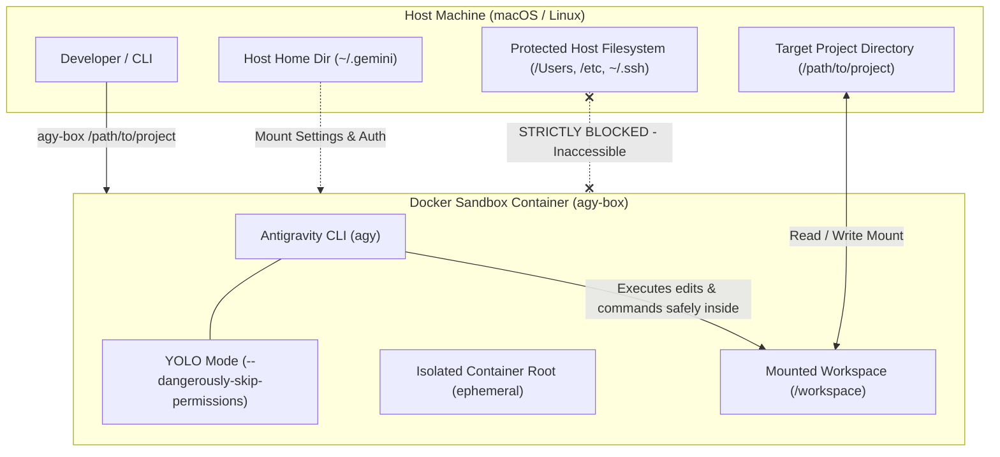
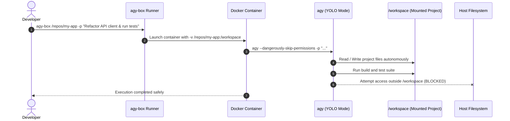
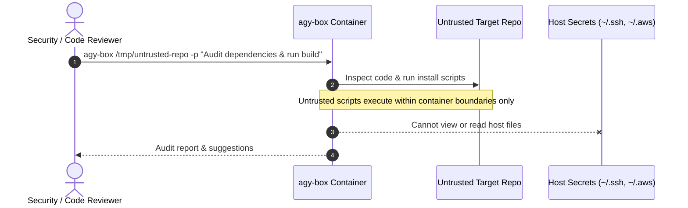
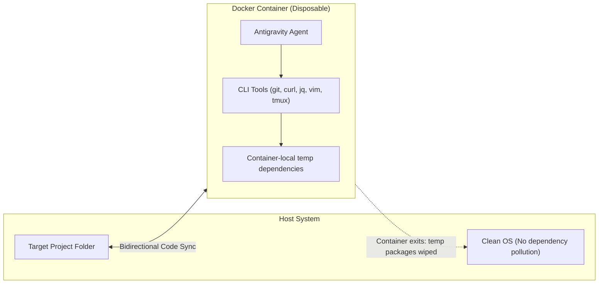

# Antigravity CLI Isolated Docker Sandbox

Run the **Antigravity CLI (`agy`)** inside an isolated Docker container with **YOLO mode** (`--dangerously-skip-permissions`), operating strictly inside a dedicated workspace folder mounted into the container.

---

## Architecture Overview

GitHub renders Mermaid diagrams natively. The diagram below illustrates how isolation and mounts work:



---

## Security & Isolation Highlights

- **Host Safety**: The container cannot touch files, system libraries, SSH keys, or environment settings outside the target folder you explicitly mount.
- **YOLO Mode**: Runs `agy` with `--dangerously-skip-permissions` so the agent executes operations autonomously without interactive approval prompts.
- **Non-Root User / UID Matching**: Runs with your host user UID and GID (`--user $(id -u):$(id -g)`) to avoid root ownership conflicts on your host files.
- **Hardened Execution**: Starts with `--security-opt=no-new-privileges:true` to prevent privilege escalation.

---

## Directory Structure

```
agy-sandbox/
├── Dockerfile           # Debian-based image with dev tools + Antigravity CLI
├── bin/
│   └── agy-box          # Convenient runner script
├── .gitignore
└── README.md
```

---

## Quick Start

### 1. Build the Image

From this repository directory:

```bash
docker build -t agy-sandbox:latest .
```

*(Note: `bin/agy-box` will build the image automatically if it is not present on your system).*

### 2. Run on a Workspace Folder

Pass any directory path as the first argument:

```bash
./bin/agy-box /path/to/your/project
```

Or pass additional `agy` CLI flags:

```bash
./bin/agy-box /path/to/your/project --model "Gemini 3.8 Flash (Medium)"
```

### 3. Add to your `PATH` (Optional)

Add `agy-sandbox/bin` to your `PATH` in `~/.zshrc` or `~/.bashrc`:

```bash
export PATH="/path/to/agy-sandbox/bin:$PATH"
```

Then invoke it anywhere:

```bash
agy-box ~/Developer/my-app
```

---

## Key Use Cases

### Use Case 1: Unattended Autonomous Refactoring & Code Generation in YOLO Mode

When running large automated tasks (e.g. repo-wide refactorings, test migrations, lint fixes), Antigravity in normal mode asks for interactive confirmation for file modifications and terminal commands. YOLO mode bypasses these prompts, but running YOLO mode directly on your primary host machine risks accidental modifications to critical parent folders or configuration files.

`agy-box` provides a protective sandbox: `agy` runs completely hands-free with full YOLO privileges, but any tool execution or command is strictly confined to the mounted workspace.



---

### Use Case 2: Untrusted Code Inspection & Vulnerability Analysis

When inspecting third-party open-source repositories, candidate submissions, or legacy services with unknown build scripts, running them directly on your host machine poses supply-chain risks (e.g., malicious `npm postinstall` scripts, unauthorized network connections, or credential scrapers looking for `~/.ssh` or `~/.aws`).

With `agy-box`, the agent can inspect, unpack, compile, and run diagnostics on untrusted source code inside a sealed container that has no access to your host environment or private credentials.



---

### Use Case 3: Clean Multi-Language Prototyping Without Host Toolchain Pollution

Developers frequently work on repositories requiring different runtimes, compiler versions, or system packages (e.g., Python dependencies, build essentials, tmux, jq). Instead of polluting your host OS or configuring virtual environments across machines:

The Docker container acts as a clean, disposable workstation where the Antigravity agent can install dependencies, run code, and create artifacts that persist cleanly in the mounted folder, leaving the host operating system completely pristine.



---

## Configuration & Credentials

The launcher automatically mounts your existing CLI config directory (`~/.gemini/antigravity-cli` and `~/.gemini/config`) and host OAuth tokens (in read-only mode) so your API keys, base URLs, and project states persist across container runs without requiring re-authentication.

You can also provide custom environment variables directly:
```bash
AGY_API_KEY="your-api-key" AGY_BASE_URL="https://your-api.endpoint/v1" agy-box /path/to/folder
```
